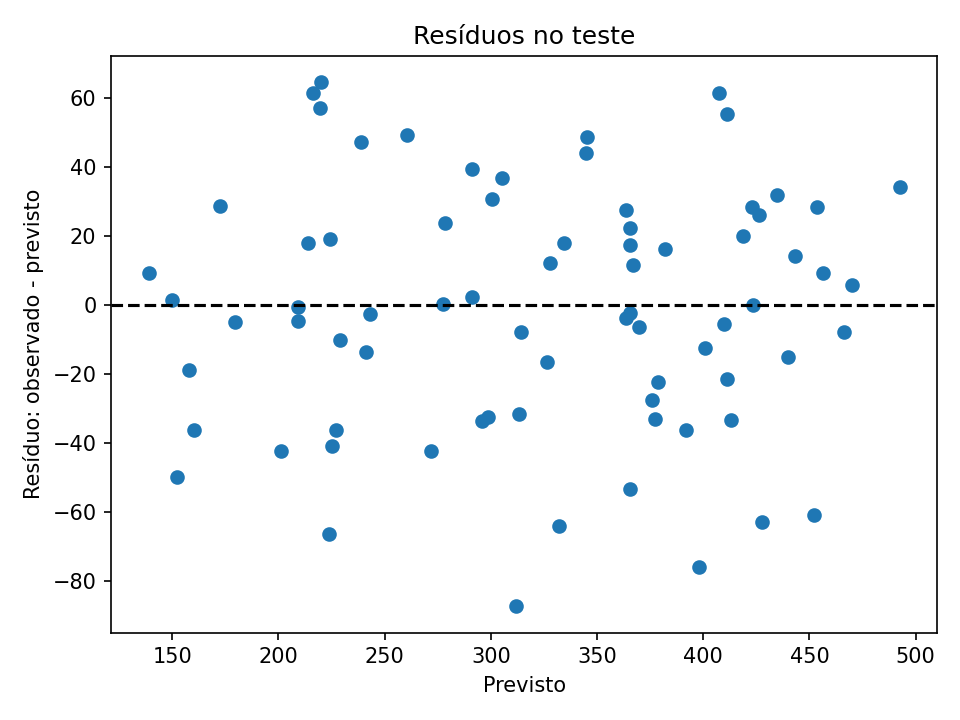

**Profa. Kadidja Valéria | UDF**  
Ciência de Dados e Aprendizado de Máquina · Sistemas de Informação · 2026.2

# Aula 2 — Registro do laboratório supervisionado

## Identificação

- Estudante ou equipe: **Lucas Dias Fortes de Andrade**
- Turma: **PREENCHER**
- Data de realização: **PREENCHER**
- Integrantes e contribuições (se em equipe): **PREENCHER**

## Percurso escolhido

- [ X] Python/Colab ou Jupyter.
- [ ] Orange Data Mining.

Use o [notebook de apoio](notebooks/laboratorio.ipynb) ou o [CSV sintético](dados/educacionais-sinteticos.csv). O CSV contém 600 registros fictícios. Atributos: `frequencia_sem4`, `nota_sem4`, `entregas_sem4`. Alvo: `evasao_fim_semestre` (0 permaneceu, 1 evadiu). As associações foram definidas pela simulação, sem validade empírica sobre estudantes reais.

## 1. Ambiente e reprodução

| Item | Registro |
| --- | --- |
| Ambiente e data | Colab|
| Versões das ferramentas/bibliotecas | Python: 3.13.18pandas: 2.2.3numpy: 2.4.6scikit-learn: 1.6.1 matplotlib: 3.10.0 |
| Semente aleatória | 42 |
| Caminho do notebook executado ou fluxo Orange | PREENCHER |
| Origem dos dados e condição sintética | PREENCHER |

## 2. Problema e preparação

- Pergunta de negócio: **quais estudantes têm maior risco de evadir até o fim do semestre, com base nos dados da semana 4?**
- Unidade de análise e horizonte: **cada linha é um estudante. Os atributos são medidos na semana 4 e o alvo é observado no fim do semestre.**
- Atributos disponíveis no instante da previsão: **frequencia_sem4, nota_sem4 e entregas_sem4**
- Variável-alvo e sua natureza: **evasao_fim_semestre, binária e categórica (0 permaneceu, 1 evadiu)**
- Ausências e outros problemas encontrados: **30 ausências em nota_sem4 (5%). Nas demais colunas, não há ausências.**
- Tratamentos e conjunto usado para aprendê-los: **Imputação das 30 ausências de nota_sem4 (5% dos registros) pela mediana. A mediana é aprendida apenas no conjunto de treino (480 registros, com 23 ausências) e aplicada ao treino e ao teste (7 ausências), por meio de um Pipeline com SimpleImputer(strategy="median").**

## 3. Desenvolvimento e teste

- Método de divisão e justificativa: **divisão holdout 80/20 com train_test_split, estratificada por evasao_fim_semestre e com random_state=SEED. A estratificação mantém a proporção de evasão (cerca de 41%) nos dois conjuntos, e a semente torna a divisão reproduzível.**
- Quantidades de treino e teste: **480 no treino e 120 no teste**
- Procedimento de validação no treino: **Validação cruzada estratificada com 5 folds (random_state=SEED) só nos 480 registros de treino, com acurácia como métrica. A mediana da imputação foi reaprendida em cada rodada, dentro do Pipeline.**
- Parâmetros da árvore e como foram escolhidos: **Comparei max_depth = 2, 3, 5 e None. Escolhi max_depth=[X] pela maior acurácia média de validação ([X]) com baixo desvio ([X]). Demais parâmetros no padrão.**
- Como o teste ficou fora da seleção: **A divisão foi feita antes de qualquer modelagem. Toda a seleção usou só o treino, e o teste foi usado uma única vez, no final.**

### Alternativa Orange

Confira o alvo como categórico. Registre as conexões: File/Select Columns → Test & Score (Data), Tree → Test & Score (Learner), Test & Score → Confusion Matrix (Evaluation Results). Data Table permite inspeção. Se usar Preprocess, conecte o preprocessor ao learner para ajustar transformações dentro do treino. Não use apenas `Test on train data` como avaliação final.

**Fluxo e método de avaliação realmente utilizados:** Não usei Orange. Usei Python no Colab

Se comparar configurações, use validação no treino e reserve teste independente. Documente em Test & Score as entradas Data e Test Data, quando utilizadas.

## 4. Resultados calculados de classificação

| Modelo | Configuração | Acurácia de treino | Acurácia de validação e dispersão | Acurácia de teste |
| --- | --- | --- | --- | --- |
| Referência | DummyClassifier(most_frequent) | 0,590 | 0,590 ± 0,005 | 0,592 |
| Árvore final | max_depth=3, imputação por mediana, random_state=SEED | 0,756 | 0,702 ± 0,028 | 0,733 |

Não invente valores. Se sua ferramenta não produziu uma medida, registre “não calculada” e explique.

**Matriz: linhas reais e colunas previstas; classe positiva = 1.**

| Real / previsto | Permaneceu (0) | Evadiu (1) |
| --- | --- | --- |
| Permaneceu (0) | 60 (TN) | 11 (FP) |
| Evadiu (1) | 21 (FN) | 28 (TP) |

- Acurácia calculada manualmente pela matriz: **(TP + TN) / total = (28 + 60) / 120 = 88 / 120 = 0,733. Confere com o Colab.**
- Sensibilidade da classe 1: **TP / (TP + FN) = 28 / (28 + 21) = 28 / 49 = 0,571 (cerca de 57%)**
- Comparação com referência: **A árvore obteve 0,733 de acurácia no teste contra 0,592 da referência, ganho de cerca de 14 pontos percentuais. A referência nunca identifica evasão (sensibilidade 0), enquanto a árvore identifica cerca de 57% dos evadidos. Treino (0,756), validação (0,702) e teste (0,733) são próximos, sem sinal forte de sobreajuste.**
- Consequências dos falsos positivos: **Falsos positivos (11): estudantes que permaneceriam, mas foram marcados como risco. Custo: apoio ou contato desnecessário, uso de recursos da equipe e possível rotulação indevida do estudante.**
- Consequências dos falsos negativos: **Falsos negativos (21): estudantes que evadiram sem serem identificados. É o erro mais grave aqui, porque eles não recebem apoio a tempo. Com 21 FN contra 28 TP, o modelo deixa passar cerca de 43% dos evadidos.**
- Interpretação do gráfico e da árvore: **A raiz da árvore usa nota_sem4 <= 6,207, indicando que a nota da semana 4 foi o atributo que mais separou evasão de permanência no treino. Notas baixas combinadas com frequência baixa (≤ 64,4%) e poucas entregas (≤ 3,5) formam a folha de maior risco (54 de 61 evadidos). Notas altas com frequência alta formam o grupo mais seguro (84 de 84 permaneceram). A folha de nota baixa com frequência alta é mista (87 e 58), o que explica parte dos falsos negativos.**

## 5. Experimentos no treino

Compare parâmetros usando apenas treino/validação. Após conhecer o teste, uma nova seleção exige novo teste independente para avaliação final.

| Experimento | Alteração | Resultado de validação | Interpretação |
| --- | --- | --- | --- |
| 1 | max_depth de 3 para None (sem limite)| 0,702 ± 0,028 → 0,710 ± 0,046 | Ganho de 0,008, menor que o desvio entre folds, então não é diferença confiável. O desvio aumentou, sinal de instabilidade da árvore profunda. |
| 2 | max_depth de 3 para 5 | 0,702 ± 0,028 → 0,677 ± 0,029 | Piora na validação. Mais profundidade não trouxe ganho e tende a ajustar ruído do treino. |

Responda:

1. Como a profundidade e o tamanho das folhas podem afetar o sobreajuste? **Árvores profundas ou com folhas muito pequenas memorizam ruído do treino: a acurácia de treino sobe, mas a de validação não acompanha. Limitar max_depth ou aumentar min_samples_leaf simplifica a árvore e melhora a generalização, com o risco de subajuste se o limite for exagerado. Nos meus experimentos, max_depth=5 e None não superaram max_depth=3 de forma convincente.**
2. Retirar um atributo e observar mudança no desempenho prova causalidade? **Não. A mudança mostra que o atributo ajuda a prever neste conjunto, mas não que causa a evasão.**
3. Se 95% permanecem, o que acontece com um modelo que sempre prevê permanência? **Teria cerca de 95% de acurácia, mas sensibilidade 0 para a classe 1: erraria todos os evadidos (todos seriam falsos negativos). A acurácia engana quando as classes são desbalanceadas, por isso é preciso olhar a matriz de confusão e a sensibilidade.**

## 6. Regressão — seção independente

Execute a seção da biblioteca no notebook ou registre o procedimento equivalente em Orange. Dados também sintéticos. Alvo numérico: empréstimos por semana.

| Item | Registro |
| --- | --- |
| Atributos e alvo | usuarios_ativos e horas_abertura. Alvo numérico: emprestimos_semana. Dados sintéticos, gerados no notebook com semente 42 (300 registros).|
| Divisão e preparação | 75% treino e 25% teste (225 e 75), random_state=42, divisão aleatória porque os registros simulados são independentes. Pipeline com imputação pela mediana e LinearRegression. Não há ausências nesses dados. |
| MAE do modelo e unidade | 28,59 empréstimos por semana |
| MAE da referência | 84,73 empréstimos por semana (prever a média do treino)|
| R² do teste | 0,8774 |
| Interpretação do gráfico observado/previsto | Os pontos se concentram em torno da linha tracejada (previsão igual ao observado), sem curvatura sistemática, e há dispersão moderada, compatível com o MAE de 28,59 e o R² de 0,877. O modelo capta bem a tendência geral, mas não prevê cada semana com exatidão|
| Interpretação dos resíduos | Os pontos se concentram em torno da linha tracejada (previsão igual ao observado), sem curvatura sistemática, e há dispersão moderada, compatível com o MAE de 28,59 e o R² de 0,877. O modelo capta bem a tendência geral, mas não prevê cada semana com exatidão. |
| Limitação de extrapolação | O modelo só foi treinado com 100 a 1000 usuários ativos e 20 a 60 horas de abertura. Prever fora dessas faixas (por exemplo, 10.000 usuários) extrapola além do domínio simulado, e a relação linear pode não valer ali. |

Explique por que R² não é porcentagem de acertos: **O R² compara o erro quadrático do modelo com o de simplesmente prever a média. Vale 1 no ajuste perfeito, 0 quando equivale à média e pode ser negativo. Como o alvo é contínuo, quase nenhuma previsão é exatamente igual ao observado, então não faz sentido contar acertos. Aqui, R² = 0,877 significa que o modelo explica cerca de 88% da variação dos empréstimos no teste, e não que acerta 88% das previsões.+**

## 7. Evidências e conclusão

- Link relativo do notebook/fluxo: **[laboratorio.ipynb](notebooks/laboratorio.ipynb)**
- Links das imagens, se houver: **

**
- Principal aprendizado: **Aprendi que a escolha de parâmetros deve usar só validação cruzada no treino, deixando o teste para uma única avaliação final. A árvore (max_depth=3) superou a referência (0,733 contra 0,592 no teste), mas identificou só 57% dos evadidos, então a acurácia sozinha não basta e é preciso olhar a matriz de confusão. Na regressão, o MAE (28,59 contra 84,73 da referência) e o R² (0,877) mostraram bom ajuste, e R² não é porcentagem de acertos.**
- Limitações de generalização e vieses possíveis: **Os dados são sintéticos e as associações foram definidas pela simulação, então os resultados não valem para estudantes reais. Há uma única divisão treino/teste (120 registros na classificação, 75 na regressão), e outra divisão poderia dar números diferentes. Em dados reais, poderia haver viés de amostragem e desigualdade entre grupos, que este conjunto não permite avaliar. A regressão não deve ser usada para extrapolar além das faixas simuladas.**
- Cuidados com privacidade e uso responsável: **Em uso real, dados de estudantes exigem acesso restrito, prazo de retenção definido, consentimento e auditoria por grupos. O modelo só deve orientar apoio voluntário, revisado por pessoas, nunca decisões automáticas ou punitivas, e deve permitir contestação. Neste trabalho foram usados apenas dados sintéticos.**

Para inserir uma imagem salva, use `` e confira se o arquivo existe. Mostre apenas dados sintéticos.

[Voltar ao início](README.md).
